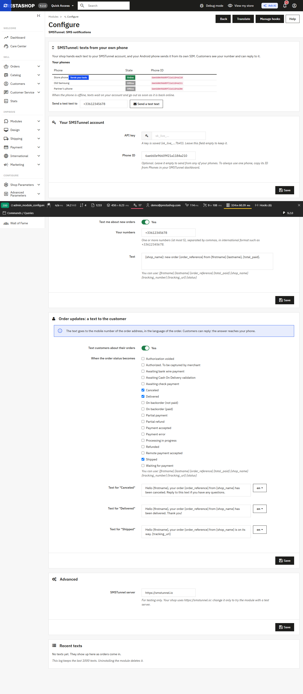

# SMSTunnel for PrestaShop

`smstunnel`: a PrestaShop module that texts your customers about their orders, and you about new orders, through **[SMSTunnel](https://smstunnel.io)**: from **your own Android phone**, with **your own number**.

Your shop hands each text to your SMSTunnel account and your phone sends it from its own SIM, so customers see a number they know and can reply to it. The phone is linked to your account when you sign in to the SMSTunnel app, and you can cut the shop off at any time by deleting its API key in your dashboard.

Your phone needs the SMSTunnel app from Google Play:

<a href="https://play.google.com/store/apps/details?id=io.smstunnel.app"></a>

SMSTunnel for PrestaShop is not affiliated with, endorsed by, or sponsored by PrestaShop SA. PrestaShop is a trademark of PrestaShop SA.

## What it does

- **New order, a text to you.** One or more of your numbers (up to 5) get a short text for every new order: `My Shop: new order XKBKNABJK from Ana Pop, €25.90.`
- **Order updates, a text to the customer.** Tick the statuses that should text the customer (Shipped, Delivered and Canceled are ticked when you install) and write a text for each one, in each of your shop's languages. The customer gets it in the language of the order, at the mobile number of the order address. The Shipped text carries the tracking link.
- **Your own wording**, with `{firstname} {lastname} {order_reference} {total_paid} {shop_name} {tracking_number} {tracking_url} {status}`.
- **A test text** from the module page, and the list of your phones, online or offline.
- **Recent texts**: the last texts, whether they went out, and why one did not. A text that did not go out can be sent again with one click.
- **Checkout never waits for SMSTunnel.** If SMSTunnel cannot be reached, the order goes through, the failure is logged in the module and in PrestaShop's log (Advanced Parameters > Logs), and you can send the text again later.
- **One text per event.** If PrestaShop runs the same hook twice, or an order gets the same status again, nothing is sent twice.
- **No texts to numbers that should not get one**: invalid numbers, premium-rate numbers, short codes and satellite networks are skipped.
- Back office in English, French, Spanish, Italian, Romanian and German, with suggested texts in those languages.

## Requirements

- PrestaShop 8.1, 8.2, 9.0, 9.1 or 9.2 (tested on 8.1.7 with PHP 7.4 and 9.2.0 with PHP 8.5), on the PHP version your PrestaShop needs (PHP 7.2.5 or newer for 8.x, 8.1 or newer for 9.x). The cURL extension, which PrestaShop requires anyway.
- An Android phone with the SMSTunnel app, and an SMSTunnel account.

## Installation

1. Download `smstunnel.zip` from the [latest release](https://github.com/narcisbodea/smstunnel-prestashop/releases/latest).
2. In your back office, open **Modules > Module Manager**, click **Upload a module** and drop the zip.
3. Click **Configure**.

To build the zip from this repository: `bash tools/build.sh` (needs Docker; it writes `build/smstunnel.zip`).

## Setup

1. Install the [SMSTunnel app from Google Play](https://play.google.com/store/apps/details?id=io.smstunnel.app) on your Android phone and sign in. Sign in at [smstunnel.io](https://smstunnel.io) on your computer with the same account: the phone appears under **Phones** (you can also link it with the QR code from **Phones → Add phone**).
2. In your [SMSTunnel dashboard](https://dashboard.smstunnel.io/apps), open **Apps → Add an app** and copy its key. The key can send texts and look up whether they went out; this module needs nothing more.
3. In PrestaShop, open the module's **Configure** page and paste the key into **API key**. Leave **Phone ID** empty to send from any of your phones; to always use one phone, copy its ID from **Phones** in your dashboard (it has a Copy button).
4. Under **New orders: a text to you**, add your number in international format (`+33612345678`).
5. Under **Order updates: a text to the customer**, tick the statuses that should text the customer and adjust the texts. Each text has a version per language of your shop.
6. Save, then use **Send a test text** at the top of the page.

The page lists your phones with their state. When a phone is offline, texts wait on your account and go out as soon as it is back online.



## How the texts are written

| Placeholder | Becomes |
| --- | --- |
| `{firstname}`, `{lastname}` | The customer's name. |
| `{order_reference}` | The order reference, such as `XKBKNABJK`. |
| `{total_paid}` | The total paid, formatted like your shop shows prices (`€25.90`, `25,90 €`). |
| `{shop_name}` | Your shop's name. |
| `{tracking_number}`, `{tracking_url}` | The tracking number of the order, and the carrier's tracking link with it (the carrier's **Tracking URL** with `@` in it). Empty until you add a tracking number. |
| `{status}` | The name of the new status, in the order's language. |

A placeholder with no value disappears without leaving double spaces, so `... is on its way. {tracking_url}` ends cleanly when there is no tracking number yet. A text can be 1600 characters long.

Leave a text as suggested, or empty, and the module uses its suggested text in the language of each order, kept up to date by module updates. The suggested texts stay in the basic SMS alphabet where the language allows it: a single character outside it (such as `ș` or `á`) makes each SMS part 70 characters long instead of 160.

## Phone numbers

The customer's number comes from the order's delivery address, mobile phone first, then phone, then the invoice address. A number written without `+` or `00` is completed with the calling code of the address country: in France `06 12 34 56 78` becomes `+33612345678`, in Romania `0721 123 456` becomes `+40721123456`, in the United States `(415) 555-0123` becomes `+14155550123`. Countries whose numbers keep their leading 0 (Italy, San Marino, Vatican, Côte d'Ivoire, Benin, Gabon, Congo) keep it. SMSTunnel also gets the country code as `defaultCountryCode`.

A number that is not valid in international format, a premium-rate number (such as `+33 89…`, `+44 90…`, `+1 900…`), a short code or a satellite network is skipped: the order goes on, and **Recent texts** says why no text went out. These are the checks of the SMSTunnel WordPress plugin.

## When something goes wrong

Texts are sent while PrestaShop saves the order or the status, with short timeouts: 3 seconds to connect to SMSTunnel, 8 seconds in all. If SMSTunnel cannot be reached, the other texts of the same page load are not tried, so a checkout waits at most a few seconds and is never stopped. The failure shows in **Recent texts** (with **Send again**), at the top of the module page, and in **Advanced Parameters > Logs**.

| Message | What to do |
| --- | --- |
| SMSTunnel refused the API key | The key was deleted, mistyped, or its account is suspended. Create a new one under **Apps → Add an app**. |
| This API key may not send texts | The key lacks the permission to send texts. Create a new one under **Apps → Add an app**. |
| Too many texts at once, or the daily limit of your plan is reached | SMSTunnel allows 30 texts a minute per key, and your plan has a daily allowance. Wait, then use **Send again**. |
| SMSTunnel could not be reached | A network or DNS problem between your server and smstunnel.io. Use **Send again** once it is solved. |
| Waiting for the phone | Your phone is offline. The text goes out when it is back online; nothing to do. |
| Skipped | The order address has no mobile number, or one that cannot be texted. Fix the address and set the status again to send it. |

## Languages

The module's pages are in English, French, Spanish, Italian, Romanian and German (PrestaShop picks the employee's language). For other languages, translate it in **International > Translations > Installed modules translations**.

## Privacy and GDPR

The module sends only transactional texts about orders: a text to your own numbers when an order comes in, and a text to the customer when their order moves to a status you chose. It sends nothing else, and nothing to people who did not order.

What goes to SMSTunnel, and why:

- **To deliver each text**: the recipient's phone number and the text itself, which can contain the customer's name, the order reference, the total, your shop's name and the tracking link, depending on your wording. SMSTunnel passes the text to your phone, which sends it.
- **To identify your shop**: your API key, the phone ID you chose, and the country calling code of the address.
- Nothing else: no email address, no postal address, no order contents, no browsing data.

What stays in your shop:

- A log of the last 1000 texts (date, order, number, text, whether it went out) in the table `PREFIX_smstunnel_log`, so you can see what went out.
- The settings, including the API key, in PrestaShop's configuration table, like the credentials of other modules.

With PrestaShop's GDPR module (Official GDPR compliance), exporting a customer's data includes the texts about their orders, and erasing a customer deletes them from the log. Uninstalling the module deletes the log and all its settings.

You are the controller of your customers' data; SMSTunnel processes the texts for you. Customers can reply to the texts: the replies reach your phone.

## Build it with an AI assistant

Want texts the module does not send, such as a back-in-stock alert or a reminder for an unpaid order? Copy this prompt into Claude, ChatGPT, Cursor or Copilot and replace the part in brackets. Never put a real API key in a prompt.

```text
I run a PrestaShop shop (PrestaShop 8.1 or newer, 9.x included) and want it to send text messages with SMSTunnel.
SMSTunnel sends texts from my own Android phone, from my own number: my code hands each text to my SMSTunnel
account and the SMSTunnel app on my phone sends it from its own SIM.

The module "SMSTunnel: SMS notifications" (technical name smstunnel) is installed: Modules > Module Manager >
Upload a module > smstunnel.zip. It already texts customers about order statuses and me about new orders. Its API
key is in PrestaShop's configuration under SMSTUNNEL_API_KEY, the optional phone ID under SMSTUNNEL_DEVICE_ID and
the server under SMSTUNNEL_API_URL (https://smstunnel.io).

SMSTunnel API facts:
- POST https://smstunnel.io/api/v1/sms/send with the headers X-API-Key: <key> and Content-Type: application/json.
- Body: {"to": "+33612345678", "message": "...", "deviceId": "<optional phone ID>", "defaultCountryCode": "<optional, e.g. +33>"}.
- Success: {"success": true, "messageId": "...", "data": {"messageId": "...", ...}}; "queued": true means my phone
  is offline and SMSTunnel keeps the text until the phone is back online.
- One recipient per call: to text several people, send one text to each.
- Up to 1600 characters per text; 30 send requests a minute per key.
- Numbers in international format (+ and country code). defaultCountryCode completes numbers written without + or 00,
  and it always wins over the phone's own country.
- Sign-in and verification codes go to POST https://smstunnel.io/api/v1/sms/send-2fa instead: the text must contain a
  code of 4 to 10 digits standing on its own (e.g. 482913 or 123-456), at most 320 characters.
- Errors are JSON such as {"message": "Invalid or expired API key", "statusCode": 401}, sometimes with a "code":
  401 = wrong or deleted key; 403 = the key lacks a permission (code PERMISSION_REQUIRED) or the plan lacks the
  feature; 429 = too many requests, wait and try again; 5xx = try again later.

What I want: [describe what should send a text, to whom, and when]

Rules for you:
- Write it as a small PrestaShop module of its own (hooks such as actionOrderStatusPostUpdate, or a front controller
  protected by a secret token for a cron job). Never edit core files or the smstunnel module.
- Keep the API key out of source code, templates and anything sent to the browser: read it with
  Configuration::get('SMSTUNNEL_API_KEY').
- Use cURL with short timeouts (3 seconds to connect, 8 in all) and catch every error: a text must never stop a
  checkout or a back office page.
- Validate numbers and turn them into international format before sending, with the address country's calling code;
  skip numbers that are not valid, premium-rate numbers and short codes.
- Handle the errors above: retry 429 and 5xx later, do not retry 401 and 403. Log failures with PrestaShopLogger.
- Only send texts people expect from my shop, such as order updates, reminders or codes they asked for.
```

## Responsible use

Send only texts that people expect from you: order updates, alerts to yourself, reminders they asked for. Unsolicited messages from a personal SIM break most carriers' terms of service. Please make sure your usage complies with your carrier's terms and with local regulations (in the EU, that includes GDPR and the ePrivacy rules on electronic communications).

## Development

```bash
bash tools/build.sh                 # build/smstunnel.zip (Composer autoloader, index.php in every folder)
bash tools/check.sh                 # php -l and unit tests on PHP 7.2, 7.4, 8.1 and 8.5
node tools/translations.mjs         # rebuild the XLIFF catalogues (fails on a missing translation)
cd tools/dev && composer install    # PrestaShop's php-dev-tools, PHPStan, php-cs-fixer (not shipped)
tools/dev/vendor/bin/php-cs-fixer fix --dry-run --diff
bash tools/check-static.sh smst-int-ps8-prestashop-1 smst-int-ps9-prestashop-1   # PHPStan level 6
```

The end-to-end tests run a throwaway PrestaShop in Docker against a **local SMSTunnel test server**, never production. They upload the zip in Module Manager, configure the module, place orders in the front office, change their status in the back office and check what the server received:

```bash
PS_IMAGE=prestashop/prestashop:9.2.0 PS_PORT=8472 docker compose -p smst-int-ps9 -f tests/docker/docker-compose.yml up -d
cd tests/e2e && npm install
SMSTUNNEL_TEST_KEY_FILE=/path/to/local-test-key.json node run.mjs --project smst-int-ps9 --port 8472 --label "PrestaShop 9.2.0"
docker compose -p smst-int-ps9 -f tests/docker/docker-compose.yml down -v
```

The test key file holds `{"serverUrl": "http://127.0.0.1:3101", "apiKey": "...", "deviceId": "..."}`. The **SMSTunnel server** field under **Advanced** exists for these tests only; a shop keeps `https://smstunnel.io`.

## Changelog

See [CHANGELOG.md](CHANGELOG.md).

## License

MIT, © NARBOWEB SRL. See [LICENSE](LICENSE).
